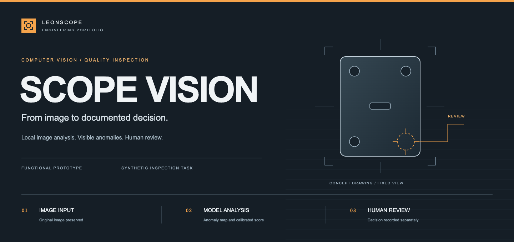
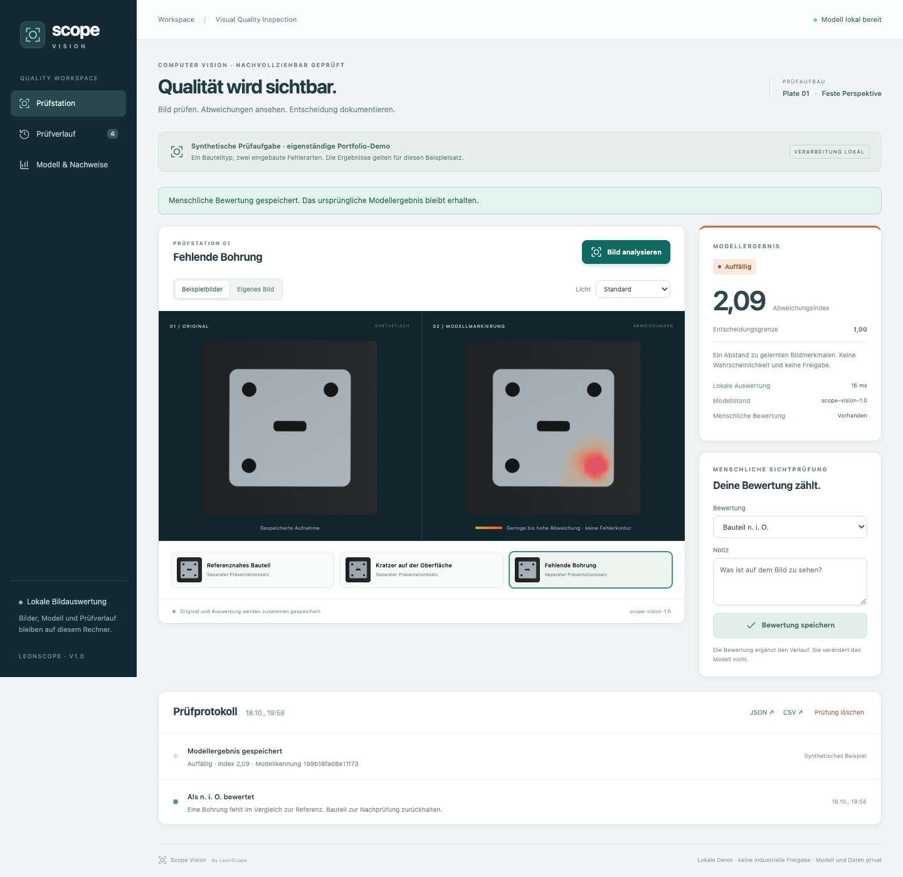
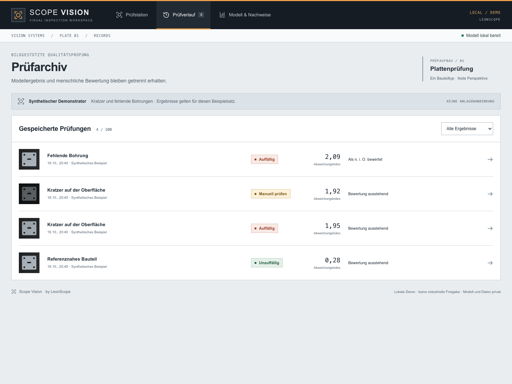
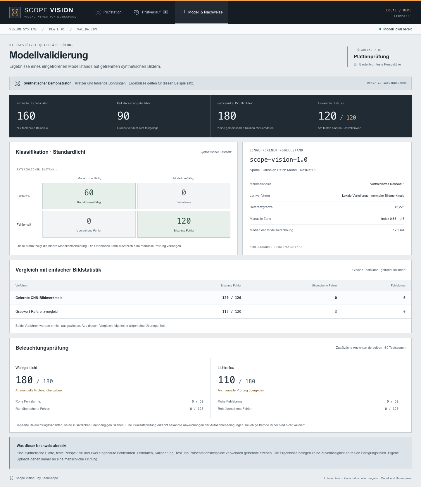
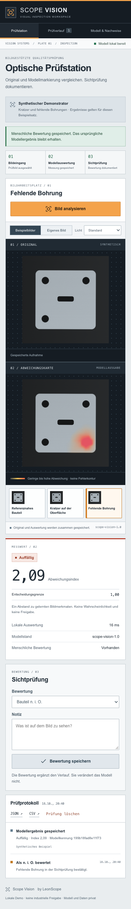

**PRODUCT BRIEF / 01** &nbsp; · &nbsp; **English** / [Deutsch](README.de.md) &nbsp; · &nbsp; [Case study](docs/CASE-STUDY.md) &nbsp; · &nbsp; [Verification](docs/VERIFICATION.md)

# Scope Vision

### Visual inspection. Visible anomalies. Recorded decisions.

A local inspection console for a fictional metal plate. The image model checks scratches and missing holes, highlights anomalous regions and hands the result over to human review. Built by **LeonScope** with AI assistance as an independent portfolio project.

| APPLICATION | INSPECTION SETUP | PROJECT STATUS |
| :--- | :--- | :--- |
| Image-based quality inspection | Synthetic plate · fixed perspective | Functional local prototype |

**This repository publishes the presentation only.** Application source, training/calibration/test data, model weights and fitted parameters remain private. No open-source or Creative Commons license is granted for the original material. [Rights notice](RIGHTS.md).

---

## 01 / The image workspace

**Inspection shown: a missing hole.** The original image and computed anomaly map sit side by side. The measured score and human assessment occupy distinct panels on the right, with the decision preserved in the inspection record below. This image comes from the separate presentation split.

| 01 · Image input | 02 · Model analysis | 03 · Human review |
| :--- | :--- | :--- |
| Choose a synthetic example or local PNG/JPEG. Change lighting as an inspection variant. | Compute the anomaly map, display the index and account for capture conditions. | Record acceptance, rejection or further review. Export the report as JSON/CSV. |

Own uploads always require human review. The anomaly index expresses distance relative to a calibrated threshold; it is not a probability or a manufacturing release. The overlay roughly indicates regions, not a measured defect boundary.

## 02 / Inspection archive and model validation

<table>
<tr>
<td width="50%" valign="top">
<strong>INSPECTION ARCHIVE</strong> Filter and reopen stored inspections. Every added assessment preserves the original model measurement.  

</td>
<td width="50%" valign="top">
<strong>MODEL VALIDATION</strong> Frozen model state, separate data splits, baseline comparison and lighting checks inside the application.  

</td>
</tr>
</table>

<strong>Open the mobile view</strong> — the same workflow at 390 pixels wide

The original image, anomaly map, score and assessment follow vertically on a phone. The workflow was checked without horizontal overflow. Application screenshots show the German interface.

## 03 / Technical specification

| Item | Implementation and observed result |
| :--- | :--- |
| Image model | Frozen pretrained ResNet18 features + locally fitted Gaussian patch distributions; inspired by PaDiM |
| Fitting and calibration | 160 normal fitting images · 90 calibration images |
| Held-out test | 180 synthetic scenes: 60 normal, 60 scratches, 60 missing holes |
| Model at standard lighting | **120 / 120 defects detected · 0 / 60 false alarms** |
| Grayscale reference baseline | **117 / 120 defects detected · 3 missed · 0 / 60 false alarms** |
| Verification | **46 application/model checks + 8 browser workflows passed** |
| Reproducibility | **436 image hashes verified · 180 test predictions reproduced** |
| Application | Python · FastAPI · PyTorch/TorchVision · React · TypeScript · SQLite |
| Interface | Industrial inspection console: graphite, steel gray, signal orange and functional outcome colors |

Results apply to the project's own synthetic sample set. They do not establish reliability on real production lines or general superiority over simpler methods. The CNN is not fine-tuned; learning here means fitting normal-feature distributions. [Evaluation method, lighting variants and limits](docs/VERIFICATION.md).

### Design and engineering decisions

The image workspace is central. A horizontal toolbar, a state-aware process strip and distinct measurement fields support the workflow. Documented interfaces from Cognex, MVTec and SensoPart informed the industry research; the design and cover illustration are original. [Design references and implementation](docs/DESIGN-NOTES.md).

The project draws on LeonScope's experience with robotics and camera-based quality inspection. It uses no employer images, customer records, industrial drawings or previous employer source code. No camera, robot or production line is connected. There is no public deployment, executable package, dataset/model download or public application CI.

---

**LEONSCOPE / ENGINEERING PORTFOLIO**

[Case study](docs/CASE-STUDY.md) · [Verification](docs/VERIFICATION.md) · [Design](docs/DESIGN-NOTES.md) · [Rights notice](RIGHTS.md) · [Profile](https://github.com/LeonScope)
