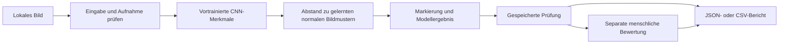

# Scope Vision — Fallstudie

[English](CASE-STUDY.md) · **Deutsch** · [Projekt](../README.de.md)

## Problem und Umfang

Eine brauchbare Bildprüfung braucht mehr als einen Modellwert. Die prüfende Person muss sehen, welches Bild untersucht wurde, die Markierung einordnen, unsichere Aufnahmebedingungen erkennen und eine Entscheidung festhalten können, ohne den ursprünglichen Nachweis zu verlieren.

Scope Vision setzt diesen vollständigen Ablauf für eine fiktive Metallplatte in fester Perspektive um. In synthetische Beispiele werden zwei bewusst sichtbare Fehlerarten eingebaut: ein Kratzer und eine fehlende Bohrung. Kleine Änderungen von Position, Textur und Helligkeit verhindern, dass jedes Bild identisch ist. Es handelt sich um eine kontrollierte Demonstration, nicht um eine Sammlung von Fertigungsfotos.

Das Projekt knüpft an LeonScopes Erfahrung mit Robotik und kameragestützter Qualitätsprüfung an. Es wurde mit KI-Unterstützung neu umgesetzt und verwendet keine Arbeitgebermaterialien oder Kundendaten. Die öffentlichen Nachweise beziehen sich ausschließlich auf diese Umsetzung.

## Vom Bild zur dokumentierten Entscheidung

Originalbild, berechnete Markierung, Modellkennung, Entscheidungsgrenze, Messwert und Zeitpunkt werden zusammen gespeichert. Menschliche Bewertungen kommen als eigene Ereignisse hinzu. Sie überschreiben das Modellergebnis nicht und trainieren den Detektor nicht automatisch nach.

Der Verlauf behält die jüngsten 100 Prüfungen und höchstens 50 Bewertungen je Prüfung. Eine bestätigte Löschung entfernt die zugehörigen Bilder und Bewertungen. JSON-Berichte enthalten den Bewertungsverlauf; CSV-Berichte fassen die letzte Bewertung zusammen.

## Warum dieses Bildmodell

Die Kameraperspektive ist fest. Daher kann ein räumliches Modell jeden Bildbereich mit normalen Beispielen an derselben Position vergleichen. Die Umsetzung extrahiert unveränderte vortrainierte ResNet18-Merkmale, kombiniert drei Merkmalsstufen und passt regularisierte Gauß-Verteilungen an normale Bildbereiche an. Bei einer Prüfung entstehen aus dem Abstand zu diesen Verteilungen eine Abweichungskarte und ein Bildmesswert.

Der Ansatz orientiert sich am [PaDiM-Verfahren für Bildbereichsverteilungen](https://anomalib.readthedocs.io/en/stable/markdown/guides/reference/models/image/padim.html). Scope Vision verwendet eine eigene kompakte Konfiguration und Auswertung. Es wird weder eine Reproduktion der Veröffentlichung noch ein Anomalib-Benchmark behauptet. Die Merkmalsbasis ist das offizielle [TorchVision-Modell ResNet18 IMAGENET1K_V1](https://docs.pytorch.org/vision/stable/models/generated/torchvision.models.resnet18.html). Das CNN wird nicht nachtrainiert; Lernen bedeutet hier die Anpassung normaler Merkmalsverteilungen.

In den Detektor gelangen ausschließlich Bildpixel. Beispielbeschreibungen und synthetische Fehlermasken werden nicht als Eingabe übergeben. Die dargestellte Markierung zeigt auffällige Regionen ungefähr an. Sie ist keine vermessene Fehlerkontur; eine Segmentierungsgenauigkeit wird nicht behauptet.

## Verständliche Entscheidungen in der Oberfläche

Die Oberfläche teilt den Rohmesswert durch die kalibrierte Entscheidungsgrenze. So entsteht ein Abweichungsindex mit einer binären Referenzgrenze von 1,00. Werte von 0,85 bis 1,15, bekannte Abweichungen der Aufnahmebedingungen und sämtliche eigenen Uploads führen zur manuellen Prüfung.

Die Aufnahmeprüfung betrachtet ein unerwartetes Seitenverhältnis, Helligkeit und Kontrast. Sie erkennt bestimmte Abweichungen und bestätigt nicht die Eignung beliebiger Bilder. Ein dunkles Bild kann eine Sichtprüfung erfordern, obwohl seine rohe Modellentscheidung korrekt ist. Die Nachweisansicht macht diesen Unterschied sichtbar.

## Entscheidungen für die Auswertung

Training, Kalibrierung, Test und Präsentation verwenden unterschiedliche Szenenkennungen desselben Generators. Nur fehlerfreie Bilder passen die Verteilungen an. Die Kalibrierung legt die Grenzen des Modells und des Vergleichsverfahrens fest. Danach wird der getrennte Test mit dem festgelegten Modellstand ausgewertet. Nach Einsicht in die Ergebnisse fand keine Nachjustierung statt.

Ein Grauwert-Referenzvergleich wird am selben Testsatz bei Standardlicht gemessen. Er erkennt 117 von 120 Fehlern; das merkmalsbasierte Modell erkennt 120. Beide erzeugen auf den 60 fehlerfreien Bildern keinen Fehlalarm. Dieser einfache Vergleich macht den Schwierigkeitsgrad der Aufgabe besser einschätzbar.

Die Lichtprüfungen verwenden gepaarte Varianten derselben Testszenen. Diese Beobachtungen werden separat ausgewiesen und nicht als zusätzliche unabhängige Testszenen gezählt. [Genaue Ergebnisse und Prüfverfahren](VERIFICATION.de.md).

## Grenzen der lokalen Anwendung

Python-API und React-Oberfläche laufen ausschließlich lokal. Modellparameter und Bilder bleiben auf dem Rechner. Hochgeladene PNG-/JPEG-Dateien werden nach Dateigröße und Abmessungen begrenzt, dekodiert und von Metadaten befreit. Host-/Herkunftsprüfungen begrenzen Anfragen; gleichzeitig läuft höchstens eine Bildauswertung. Die Oberfläche wird am Desktop und in einer Smartphone-Ansicht geprüft.

Es ist ein Prototyp für eine lokale Person, ohne produktive Benutzerverwaltung, Kameraaufnahme, Robotersteuerung, Betriebsüberwachung oder industrielle Abnahme. Der nächste belastbare Validierungsschritt wäre eine gesondert freigegebene Untersuchung echter Bilder mit kontrollierter Aufnahme, neuen ungesehenen Testchargen und einer passenden Abnahmespezifikation.

## Beitrag zum Portfolio

Die gezeigte Arbeit umfasst Problemabgrenzung, Spezifikation synthetischer Daten, einen angepassten Anomaliedetektor, Kalibrierung und Vergleichsverfahren, lokale API/Speicherung, einen anpassungsfähigen Prüfablauf, automatisierte Prüfungen und zweisprachige Dokumentation. Die Ergebnisse sind lokale Beobachtungen. Ein Kundenauftrag, eine reale Einführung in der Fertigung oder eine autonome Fertigungsentscheidung werden damit nicht behauptet.

Öffentlich sind ausschließlich diese Präsentation und ausgewählte Bildschirmansichten. Quellcode, Datensätze, Modellartefakte und die private Entwicklungshistorie liegen außerhalb dieses Repositorys. [Rechtehinweis](../RIGHTS.md).
