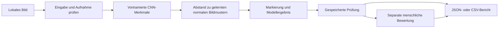

# Scope Vision — Fallstudie

[English](CASE-STUDY.md) · **Deutsch** · [Projekt](../README.de.md)

## Die Prüfaufgabe

Scope Vision untersucht Bilder einer fiktiven Metallplatte aus einer festen Perspektive. In den erzeugten Bildern kommen zwei Fehlerarten vor: ein Kratzer und eine fehlende Bohrung. Position, Textur und Helligkeit variieren leicht.

Die Oberfläche zeigt das Original neben der berechneten Markierung. So kann die prüfende Person den Modellwert mit dem Bild vergleichen und eine eigene Bewertung speichern. Auch Hinweise auf ungünstige Aufnahmebedingungen werden angezeigt.

Das Thema kommt aus meiner Erfahrung mit Robotik und kameragestützter Qualitätsprüfung. Für dieses Projekt wurden Anwendung und Bilder neu erstellt. Fotos aus einer Fertigung, Arbeitgebermaterialien oder Kundendaten werden nicht verwendet.

## Vom Bild zur dokumentierten Entscheidung

Originalbild, berechnete Markierung, Modellkennung, Entscheidungsgrenze, Messwert und Zeitpunkt werden zusammen gespeichert. Menschliche Bewertungen kommen als eigene Ereignisse hinzu. Sie überschreiben das Modellergebnis nicht und trainieren den Detektor nicht automatisch nach.

Der Verlauf behält die jüngsten 100 Prüfungen und höchstens 50 Bewertungen je Prüfung. Eine bestätigte Löschung entfernt die zugehörigen Bilder und Bewertungen. JSON-Berichte enthalten den Bewertungsverlauf; CSV-Berichte fassen die letzte Bewertung zusammen.

## Warum dieses Bildmodell

Die Kameraperspektive ist fest. Daher kann ein räumliches Modell jeden Bildbereich mit normalen Beispielen an derselben Position vergleichen. Die Umsetzung extrahiert unveränderte vortrainierte ResNet18-Merkmale, kombiniert drei Merkmalsstufen und passt regularisierte Gauß-Verteilungen an normale Bildbereiche an. Bei einer Prüfung entstehen aus dem Abstand zu diesen Verteilungen eine Abweichungskarte und ein Bildmesswert.

Der Ansatz orientiert sich am [PaDiM-Verfahren für Bildbereichsverteilungen](https://anomalib.readthedocs.io/en/stable/markdown/guides/reference/models/image/padim.html). Scope Vision verwendet eine eigene kompakte Konfiguration und Auswertung. Die Umsetzung übernimmt nicht alle Details der Veröffentlichung und ist nicht mit einem Anomalib-Benchmark gleichzusetzen. Die Merkmalsbasis ist das offizielle [TorchVision-Modell ResNet18 IMAGENET1K_V1](https://docs.pytorch.org/vision/stable/models/generated/torchvision.models.resnet18.html). Das CNN wird nicht nachtrainiert; Lernen bedeutet hier die Anpassung normaler Merkmalsverteilungen.

In den Detektor gelangen ausschließlich Bildpixel. Beispielbeschreibungen und synthetische Fehlermasken werden nicht als Eingabe übergeben. Die dargestellte Markierung zeigt auffällige Regionen ungefähr an. Wie genau die Markierung die Fehlerkontur trifft, wurde nicht vermessen.

## Verständliche Entscheidungen in der Oberfläche

Die Oberfläche teilt den Rohmesswert durch die kalibrierte Entscheidungsgrenze. So entsteht ein Abweichungsindex mit einer binären Referenzgrenze von 1,00. Werte von 0,85 bis 1,15, bekannte Abweichungen der Aufnahmebedingungen und sämtliche eigenen Uploads führen zur manuellen Prüfung.

Die Aufnahmeprüfung betrachtet ein unerwartetes Seitenverhältnis, Helligkeit und Kontrast. Sie erkennt bestimmte Abweichungen und bestätigt nicht die Eignung beliebiger Bilder. Ein dunkles Bild kann eine Sichtprüfung erfordern, obwohl seine rohe Modellentscheidung korrekt ist. Die Nachweisansicht macht diesen Unterschied sichtbar.

## Industrielle Bedienoberfläche

Eine horizontale Werkzeugleiste führt zu Prüfstation, Archiv und Modellvalidierung. Original und Abweichungskarte liegen auf einer dunklen Bildarbeitsfläche; Messwert und Sichtprüfung bleiben separat. Der Ablaufstreifen zeigt, ob ein Bild ausgewählt, ausgewertet und bewertet wurde. Die Oberfläche verwendet Graphit, Stahlgrau und Orange. [Herstellerreferenzen und Gestaltungsentscheidungen](DESIGN-NOTES.md).

## Entscheidungen für die Auswertung

Training, Kalibrierung, Test und Präsentation verwenden unterschiedliche Szenenkennungen desselben Generators. Nur fehlerfreie Bilder passen die Verteilungen an. Die Kalibrierung legt die Grenzen des Modells und des Vergleichsverfahrens fest. Danach wird der getrennte Test mit dem festgelegten Modellstand ausgewertet. Nach Einsicht in die Ergebnisse fand keine Nachjustierung statt.

Ein Grauwert-Referenzvergleich wird am selben Testsatz bei Standardlicht gemessen. Er erkennt 117 von 120 Fehlern; das merkmalsbasierte Modell erkennt 120. Beide erzeugen auf den 60 fehlerfreien Bildern keinen Fehlalarm. Dieser einfache Vergleich macht den Schwierigkeitsgrad der Aufgabe besser einschätzbar.

Die Lichtprüfungen verwenden gepaarte Varianten derselben Testszenen. Diese Beobachtungen werden separat ausgewiesen und nicht als zusätzliche unabhängige Testszenen gezählt. [Genaue Ergebnisse und Prüfverfahren](VERIFICATION.de.md).

## Grenzen der lokalen Anwendung

Python-API und React-Oberfläche laufen ausschließlich lokal. Modellparameter und Bilder bleiben auf dem Rechner. Hochgeladene PNG-/JPEG-Dateien werden nach Dateigröße und Abmessungen begrenzt, dekodiert und von Metadaten befreit. Host-/Herkunftsprüfungen begrenzen Anfragen; gleichzeitig läuft höchstens eine Bildauswertung. Die Oberfläche wird am Desktop und in einer Smartphone-Ansicht geprüft.

Der Prototyp ist für eine Person am lokalen Rechner gedacht. Benutzerverwaltung für den Produktivbetrieb, Kameraaufnahme, Robotersteuerung und Betriebsüberwachung sind nicht eingebaut; eine industrielle Abnahme hat nicht stattgefunden. Für eine weitere Bewertung wären echte Bilder unter kontrollierten Aufnahmebedingungen, neue Testchargen und festgelegte Abnahmekriterien nötig.

## Mein Anteil und die KI-Unterstützung

Ich habe das Thema für mein Portfolio ausgewählt und den industriellen Auftritt sowie die Grenzen der Veröffentlichung vorgegeben. Codex erstellte Anwendung, synthetische Daten, Modellumsetzung, Tests und Dokumentation und führte die lokalen Prüfungen aus.

Die Fallstudie beschreibt dieses neue Projekt. Meine frühere Arbeit in der Fertigung ist der fachliche Hintergrund, aber kein Nachweis für die Zuverlässigkeit dieses Prototyps an einer echten Linie.

Öffentlich sind die Präsentation und ausgewählte Bildschirmansichten. Quellcode, Datensätze, Modellartefakte und Entwicklungshistorie bleiben privat. [Rechtehinweis](../RIGHTS.md).
