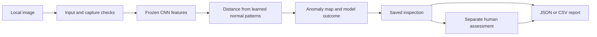

# Scope Vision — case study

**English** · [Deutsch](CASE-STUDY.de.md) · [Project](../README.md)

## Problem and scope

A useful visual inspection tool needs more than a model score. Someone must see which image was inspected, understand the highlighted area, recognize uncertain capture conditions and document a decision without losing the original evidence.

Scope Vision implements this complete workflow for a fictional metal plate in a fixed perspective. Two deliberately visible defect types are built into synthetic examples: a scratch and a missing hole. Small variations in position, texture and brightness prevent every image from being identical. This is a controlled demonstration, not a collection of factory photographs.

The project draws on LeonScope's experience with robotics and camera-based quality inspection. It was newly implemented with AI assistance and uses no employer assets or customer records. The public evidence concerns this implementation only.

## From image to recorded decision

The original image, computed overlay, model identifier, threshold, score and timestamp are stored together. Human assessments are appended as separate events. They do not overwrite the model result and do not automatically retrain the detector.

The history retains the latest 100 inspections and at most 50 assessments per inspection. Confirmed deletion removes the corresponding images and assessments. JSON exports preserve the assessment history; CSV exports summarize the latest assessment.

## Why this image model

The camera perspective is fixed, so a spatial model can compare each image region with normal examples from the same position. The implementation extracts frozen pretrained ResNet18 features, combines three feature stages and fits regularized Gaussian distributions to normal patch features. At inference, distance from those distributions produces an anomaly map and an image score.

This approach is inspired by [PaDiM's patch-distribution method](https://anomalib.readthedocs.io/en/stable/markdown/guides/reference/models/image/padim.html). Scope Vision uses its own compact configuration and evaluation; it is not claimed as a reproduction of the paper or an Anomalib benchmark. The feature extractor is the official [TorchVision ResNet18 IMAGENET1K_V1 model](https://docs.pytorch.org/vision/stable/models/generated/torchvision.models.resnet18.html). The CNN is not fine-tuned; learning here means fitting the normal-feature distributions.

Inference receives the image pixels only. Example descriptions and synthetic defect masks are not provided to the detector. The displayed overlay is a coarse indication of anomalous regions, not a measured defect boundary. No segmentation accuracy is claimed.

## Decisions visible to the operator

The interface divides the raw score by the calibrated threshold to obtain an anomaly index. The binary reference boundary is therefore 1.00. Values from 0.85 to 1.15, known capture-quality deviations, and every own upload are routed to manual review.

Capture checks look for unexpected aspect ratio, brightness and contrast. They catch specified deviations rather than proving arbitrary input validity. A dim image can require review even when its raw model classification is correct. The evaluation screen makes this difference visible.

## Evaluation decisions

Training, calibration, test and presentation use different scene seeds from the same generator. Only normal images fit the distributions. Calibration selects the model and baseline thresholds. The held-out test is then evaluated using the frozen model state. No tuning was performed after viewing its results.

A grayscale reference comparison is measured on the same standard-light test. It detects 117 of 120 defects; the feature-based detector detects 120. Both produce zero false alarms on the 60 normal images. The simple baseline makes the task's relative difficulty visible instead of presenting the learned model alone.

Lighting stress uses paired variants of the same held-out scenes. These observations are reported separately and are not counted as additional independent test scenes. [Exact results and verification method](VERIFICATION.md).

## Local product boundaries

The Python API and React interface run on loopback. Model parameters and images stay local. Uploaded PNG/JPEG files are bounded by encoded size and dimensions, decoded and stripped of metadata. Host/origin checks restrict requests; one inference can run at a time. The UI is checked at desktop and mobile sizes.

This is a single-user prototype without production authentication, camera acquisition, robot control, deployment monitoring or an industrial acceptance process. The next meaningful validation step would be a separately authorized real-image study with controlled capture conditions, new unseen test batches and an appropriate acceptance specification.

## Portfolio contribution

The demonstrated work includes problem framing, a synthetic data specification, a fitted anomaly detector, calibration and baseline comparison, local API/storage, a responsive inspection workflow, automated checks and bilingual documentation. Quoted results are local observations. No client project, real factory rollout or autonomous manufacturing decision is implied.

Only this presentation and selected screenshots are public. Source code, datasets, model artifacts and private development history remain outside this repository. [Rights notice](../RIGHTS.md).
